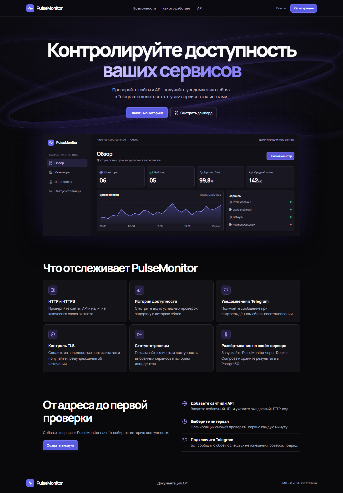
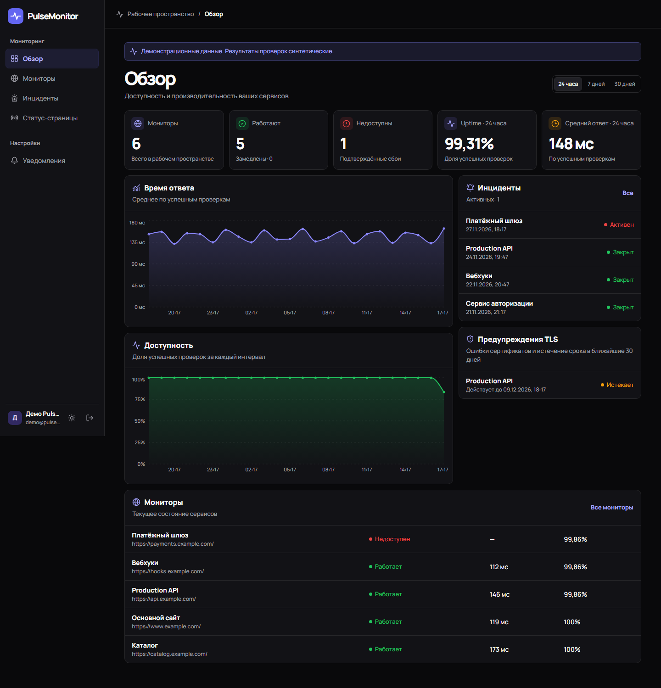
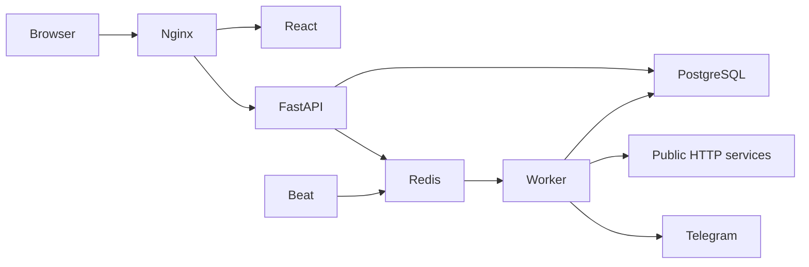

#  PulseMonitor

English · [Русский](README.ru.md)

Self-hosted uptime and incident monitoring for websites and APIs. PulseMonitor runs scheduled HTTP checks, stores results in PostgreSQL and shows availability, latency and incidents in a Russian-language workspace.

## Features

- HTTP/HTTPS and keyword checks with configurable interval, timeout, expected status and response-time threshold. Bare public hostnames default to HTTPS.
- Availability over 24 hours, 7 days and 30 days, plus average, minimum, maximum and P95 latency on successful checks.
- Dashboard with availability and latency charts, service counts, incidents and TLS warnings.
- Incident tracking after two consecutive failures and automatic resolution after recovery.
- TLS certificate validity, hostname verification and expiry alerts.
- Telegram notifications with confirmed account linking and delivery history.
- Public status pages that expose selected service labels and availability metrics.
- Password-based accounts, administrative blocking, read-only synthetic demo and dark/light workspace themes.

## Screenshots

| Landing | Dashboard with synthetic data |
| --- | --- |
|  |  |

## Start locally

Requirements are Docker with Linux containers and Docker Compose v2. On Windows, start Docker Desktop first. Generate local secrets on first setup and keep `.env` outside version control. If `.env` is already configured, run only the last command.

**PowerShell 7**

```powershell
Copy-Item .env.example .env
$databaseSecret = [Convert]::ToHexString([Security.Cryptography.RandomNumberGenerator]::GetBytes(24)).ToLower()
$jwtSecret = [Convert]::ToHexString([Security.Cryptography.RandomNumberGenerator]::GetBytes(48)).ToLower()
(Get-Content .env) -replace '^POSTGRES_PASSWORD=$', "POSTGRES_PASSWORD=$databaseSecret" -replace '^JWT_SECRET_KEY=$', "JWT_SECRET_KEY=$jwtSecret" | Set-Content .env
docker compose up --build -d --wait
```

**Linux / macOS**

```sh
cp .env.example .env
db_secret=$(openssl rand -hex 24)
jwt_secret=$(openssl rand -hex 48)
sed -e "s/^POSTGRES_PASSWORD=$/POSTGRES_PASSWORD=$db_secret/" -e "s/^JWT_SECRET_KEY=$/JWT_SECRET_KEY=$jwt_secret/" .env.example > .env
docker compose up --build -d --wait
```

Open [http://localhost](http://localhost) and register an account. Add a public HTTP(S) URL and allow the scheduler up to 10 seconds to queue it. The workspace refreshes metrics every 30 seconds. API documentation is at [http://localhost/api/docs](http://localhost/api/docs).

Set both `APP_PORT` and `FRONTEND_URL` if the default port is in use. For example, use `APP_PORT=8080` and `FRONTEND_URL=http://localhost:8080`.

## Configuration

| Variables | Purpose |
| --- | --- |
| `POSTGRES_DB`, `POSTGRES_USER`, `POSTGRES_PASSWORD` | PostgreSQL database and credentials. The password is required. Use URL-safe random characters. |
| `JWT_SECRET_KEY` | Required random signing secret, at least 32 characters. |
| `APP_ENV`, `APP_DEBUG` | Use `APP_ENV=production` and `APP_DEBUG=false` on a server. |
| `FRONTEND_URL`, `EXTRA_ORIGINS` | Exact browser origin and optional comma-separated origins. Production requires HTTPS. |
| `APP_BIND_ADDRESS`, `APP_PORT` | Host listener, default `127.0.0.1:80`. |
| `DATABASE_URL`, `REDIS_URL` | Optional overrides for managed services or development outside Compose. |
| `JWT_ACCESS_TOKEN_EXPIRE_MINUTES`, `JWT_REFRESH_TOKEN_EXPIRE_DAYS` | Session lifetimes, 15 minutes and 7 days by default. |
| `MAX_MONITORS_PER_USER`, `CHECK_RETENTION_DAYS` | Defaults to 20 monitors per account and 30 days of detailed checks. |
| `TELEGRAM_BOT_TOKEN`, `TELEGRAM_BOT_USERNAME` | Optional Telegram credentials. |
| `DEMO_MODE` | Enables login to a demo account created explicitly by the seed command. |

## Telegram and demo data

1. Create a dedicated bot with BotFather. Set `TELEGRAM_BOT_TOKEN` and `TELEGRAM_BOT_USERNAME` without the `@` prefix.
2. Run `docker compose up -d` so the API and worker pick up the configuration. The worker periodically polls Telegram for bot updates. The bot must have no active webhook.
3. Open **Уведомления** in the workspace, generate the one-time link and press **Запустить** in the bot's private chat. After the workspace shows the connection, send a test message.

For a demo, set `DEMO_MODE=true` in a development environment and recreate the affected containers with `docker compose up -d`. Choose a demo password when prompted.

```sh
docker compose exec backend python -m app.manage seed-demo --email demo@example.com
```

The command creates six synthetic monitors with 30 days of checks, resolved and active incidents, and a public example status page. The demo account is read-only. To promote an existing regular account, run `docker compose exec backend python -m app.manage promote-admin --email your-email@example.com`.

## Tests

```sh
cd frontend
npm ci
npm run lint
npm run test
npm run build
npx playwright install chromium
npm run test:e2e
```

The browser tests require a running local Compose stack and create temporary application accounts. Run them against a disposable development database. Set `PULSE_E2E_URL` for a different origin.

For backend tests, use Python 3.12, PostgreSQL 16 and Redis 7. Supply `TEST_DATABASE_URL` for an empty dedicated database whose name ends in `_test`, plus `TEST_REDIS_URL` for an isolated Redis database. Export them as `DATABASE_URL` and `REDIS_URL` for the migration step and supply a random `JWT_SECRET_KEY`.

```sh
cd backend
python -m pip install -r requirements-dev.txt
alembic upgrade head
alembic check
pytest -q
```

## Architecture and deployment

React 19, TypeScript, Vite, Tailwind CSS, shadcn/Radix primitives, Lucide, TanStack Query, React Router and Recharts power the workspace. The API uses FastAPI, Pydantic, SQLAlchemy Async, Alembic, PostgreSQL, Redis, Celery, HTTPX, JWT and Argon2id.



See [Architecture](docs/ARCHITECTURE.md) for job and data flow and [Deployment](docs/DEPLOYMENT.md) for Linux VPS, TLS, network isolation and backups.

Uptime is the percentage of completed checks that succeeded. It estimates availability at the check interval. Keyword checks inspect the first 1 MiB of an identity-encoded response. HTTP/HTTPS monitoring accepts the common web ports 80, 443, 8080 and 8443.

The roadmap includes TCP monitoring, SMTP, team roles, regional probes and SLA exports.

## Contributors

- [zxcst1ralka](https://github.com/zxcst1ralka)

## License

[MIT](LICENSE)
