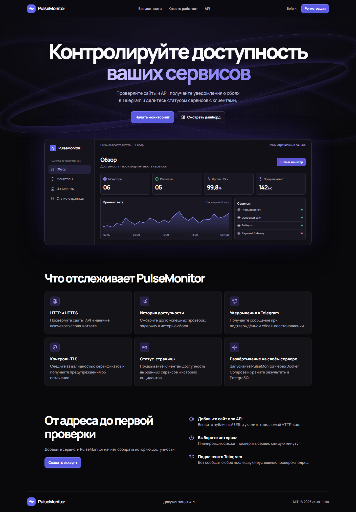
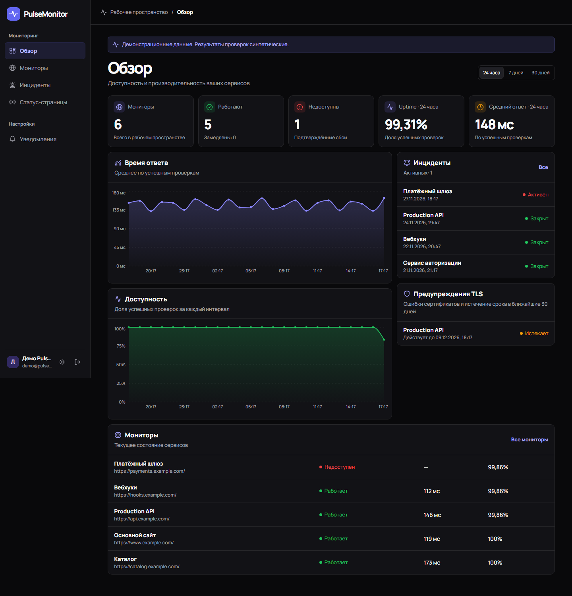
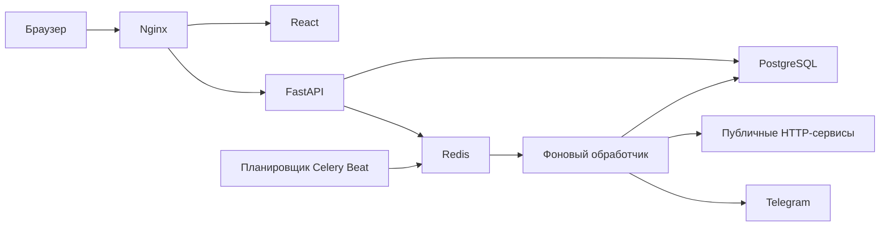

#  PulseMonitor

[English](README.md) · Русский

PulseMonitor отслеживает доступность сайтов и API и помогает следить за инцидентами. Сервис можно развернуть на своём сервере. Он выполняет HTTP-проверки по расписанию, хранит результаты в PostgreSQL и показывает доступность, время ответа и инциденты в русскоязычном интерфейсе.

## Возможности

- HTTP/HTTPS-проверки и поиск ключевых слов с настройкой интервала, таймаута, ожидаемого HTTP-кода и порога времени ответа. Для публичного доменного имени без протокола используется HTTPS.
- Доступность за 24 часа, 7 и 30 дней. По успешным проверкам рассчитываются среднее, минимальное и максимальное время ответа, а также 95-й перцентиль (P95).
- Дашборд с графиками доступности и времени ответа, количеством сервисов, инцидентами и предупреждениями TLS.
- Автоматическое открытие инцидента после двух неуспешных проверок подряд и закрытие после восстановления.
- Проверка валидности TLS-сертификата и соответствия имени хоста, уведомления об истечении срока действия.
- Telegram-уведомления с подтверждением привязки аккаунта и историей доставки.
- Публичные статус-страницы с названиями выбранных сервисов и показателями их доступности.
- Вход по паролю, блокировка аккаунтов администратором, демонстрационный режим с синтетическими данными только для чтения, тёмная и светлая темы рабочего пространства.

## Скриншоты

| Главная страница | Дашборд с синтетическими данными |
| --- | --- |
|  |  |

## Локальный запуск

Понадобятся Docker с Linux-контейнерами и Docker Compose v2. На Windows сначала запустите Docker Desktop. При первой настройке сгенерируйте секреты и сохраните их в локальном файле `.env`, который следует хранить вне системы контроля версий. Если файл уже настроен, выполните только последнюю команду.

**PowerShell 7**

```powershell
Copy-Item .env.example .env
$databaseSecret = [Convert]::ToHexString([Security.Cryptography.RandomNumberGenerator]::GetBytes(24)).ToLower()
$jwtSecret = [Convert]::ToHexString([Security.Cryptography.RandomNumberGenerator]::GetBytes(48)).ToLower()
(Get-Content .env) -replace '^POSTGRES_PASSWORD=$', "POSTGRES_PASSWORD=$databaseSecret" -replace '^JWT_SECRET_KEY=$', "JWT_SECRET_KEY=$jwtSecret" | Set-Content .env
docker compose up --build -d --wait
```

**Linux / macOS**

```sh
cp .env.example .env
db_secret=$(openssl rand -hex 24)
jwt_secret=$(openssl rand -hex 48)
sed -e "s/^POSTGRES_PASSWORD=$/POSTGRES_PASSWORD=$db_secret/" -e "s/^JWT_SECRET_KEY=$/JWT_SECRET_KEY=$jwt_secret/" .env.example > .env
docker compose up --build -d --wait
```

Откройте [http://localhost](http://localhost) и зарегистрируйтесь. Добавьте публичный HTTP(S)-адрес. Планировщик поставит проверку в очередь в течение 10 секунд. Показатели обновляются каждые 30 секунд. Документация API доступна по адресу [http://localhost/api/docs](http://localhost/api/docs).

Если порт по умолчанию занят, задайте `APP_PORT` и `FRONTEND_URL`. Например, `APP_PORT=8080` и `FRONTEND_URL=http://localhost:8080`.

## Настройки

| Переменные | Назначение |
| --- | --- |
| `POSTGRES_DB`, `POSTGRES_USER`, `POSTGRES_PASSWORD` | Имя базы данных и учётные данные PostgreSQL. Пароль обязателен. Используйте случайные символы, допустимые в URL. |
| `JWT_SECRET_KEY` | Обязательный случайный ключ подписи JWT длиной не менее 32 символов. |
| `APP_ENV`, `APP_DEBUG` | Для сервера используйте `APP_ENV=production` и `APP_DEBUG=false`. |
| `FRONTEND_URL`, `EXTRA_ORIGINS` | Источник (origin) интерфейса и необязательный список дополнительных источников через запятую. В рабочей среде требуется HTTPS. |
| `APP_BIND_ADDRESS`, `APP_PORT` | Адрес и порт на хосте. По умолчанию `127.0.0.1:80`. |
| `DATABASE_URL`, `REDIS_URL` | Необязательные адреса подключения для управляемых сервисов или разработки вне Compose. |
| `JWT_ACCESS_TOKEN_EXPIRE_MINUTES`, `JWT_REFRESH_TOKEN_EXPIRE_DAYS` | Сроки действия токенов доступа и обновления. По умолчанию 15 минут и 7 дней соответственно. |
| `MAX_MONITORS_PER_USER`, `CHECK_RETENTION_DAYS` | По умолчанию 20 мониторов на аккаунт и 30 дней хранения детальной истории проверок. |
| `TELEGRAM_BOT_TOKEN`, `TELEGRAM_BOT_USERNAME` | Необязательные токен и имя Telegram-бота. |
| `DEMO_MODE` | Разрешает вход в демо-аккаунт, созданный командой наполнения базы. |

## Telegram и демонстрационные данные

1. Создайте отдельного бота через BotFather. Укажите токен в `TELEGRAM_BOT_TOKEN` и имя бота без префикса `@` в `TELEGRAM_BOT_USERNAME`.
2. Выполните `docker compose up -d`, чтобы API и фоновый обработчик получили настройки. Обработчик периодически запрашивает обновления бота через Telegram API. У бота не должно быть активного вебхука.
3. Откройте раздел **Уведомления**, создайте одноразовую ссылку и нажмите **Запустить** в личном чате с ботом. Когда в интерфейсе появится отметка о подключении, отправьте тестовое сообщение.

Чтобы включить деморежим в среде разработки, задайте `DEMO_MODE=true` и пересоздайте затронутые контейнеры командой `docker compose up -d`. При запуске команды ниже задайте пароль для демо-аккаунта.

```sh
docker compose exec backend python -m app.manage seed-demo --email demo@example.com
```

Команда создаёт шесть синтетических мониторов с историей проверок за 30 дней, закрытые и активные инциденты и пример публичной статус-страницы. Демо-аккаунт доступен только для чтения. Чтобы выдать права администратора существующему обычному аккаунту, выполните `docker compose exec backend python -m app.manage promote-admin --email your-email@example.com`.

## Тесты

```sh
cd frontend
npm ci
npm run lint
npm run test
npm run build
npx playwright install chromium
npm run test:e2e
```

Браузерным тестам нужен запущенный локальный стек Compose. Тесты создают временные аккаунты, поэтому запускайте их на отдельной базе для разработки, которую можно удалить. Если приложение работает на другом адресе, задайте `PULSE_E2E_URL`.

Для backend-тестов используйте Python 3.12, PostgreSQL 16 и Redis 7. Задайте `TEST_DATABASE_URL` для отдельной пустой базы с именем, оканчивающимся на `_test`, и `TEST_REDIS_URL` для изолированной базы Redis. Перед запуском миграций экспортируйте те же значения в `DATABASE_URL` и `REDIS_URL`, а также задайте случайный `JWT_SECRET_KEY`.

```sh
cd backend
python -m pip install -r requirements-dev.txt
alembic upgrade head
alembic check
pytest -q
```

## Архитектура и развёртывание

Интерфейс использует React 19, TypeScript, Vite, Tailwind CSS, примитивы shadcn/Radix, Lucide, TanStack Query, React Router и Recharts. API использует FastAPI, Pydantic, SQLAlchemy Async, Alembic, PostgreSQL, Redis, Celery, HTTPX, JWT и Argon2id.



Потоки задач и данных описаны в [документации по архитектуре](docs/ARCHITECTURE.md). Настройка Linux VPS, TLS, сетевой изоляции и резервного копирования описана в [руководстве по развёртыванию](docs/DEPLOYMENT.md). Оба руководства на английском.

Uptime — доля успешных проверок среди всех завершённых. Этот показатель оценивает доступность с учётом выбранного интервала. При поиске ключевого слова проверяется первый 1 МиБ ответа без сжатия (`identity`). Для HTTP/HTTPS-мониторинга доступны порты 80, 443, 8080 и 8443.

В планах TCP-мониторинг, SMTP, командные роли, проверки из разных регионов и экспорт данных по SLA.

## Участники

- [zxcst1ralka](https://github.com/zxcst1ralka)

## Лицензия

[MIT](LICENSE)
